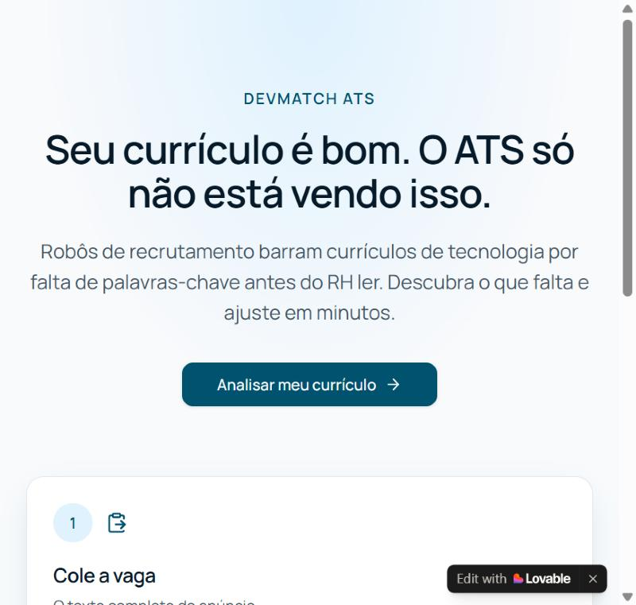
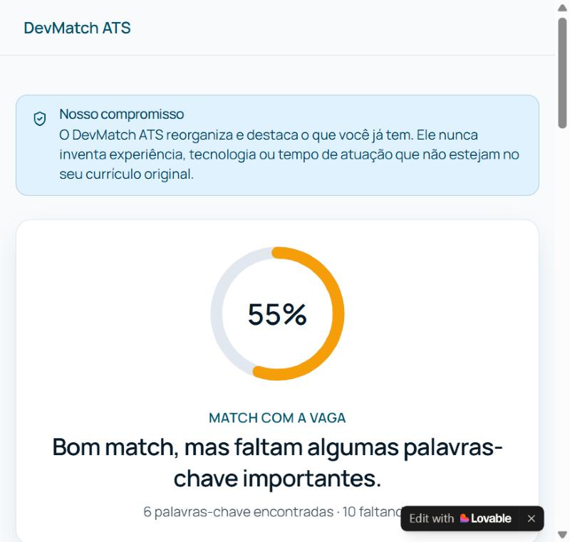
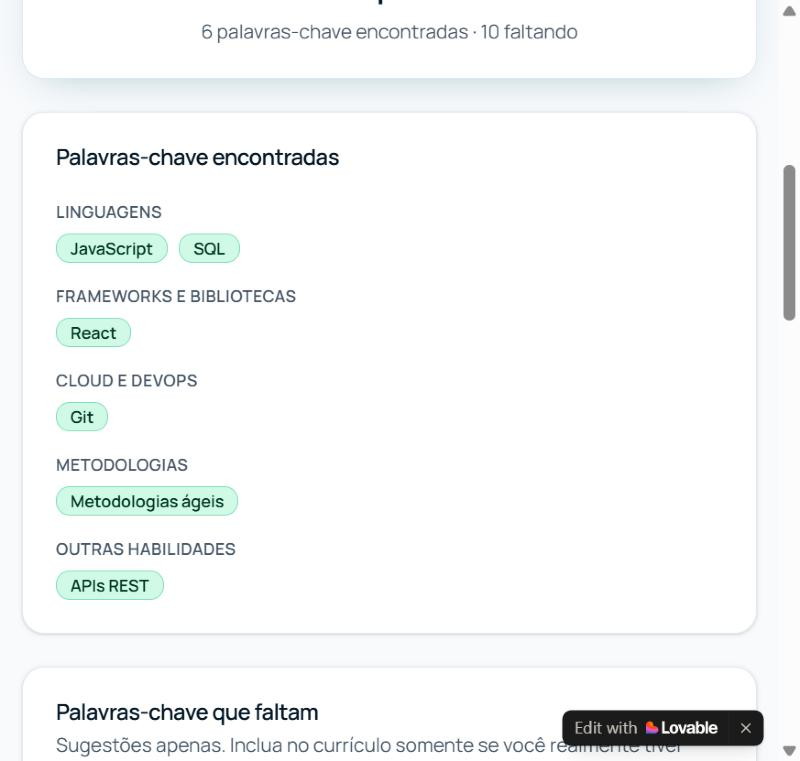
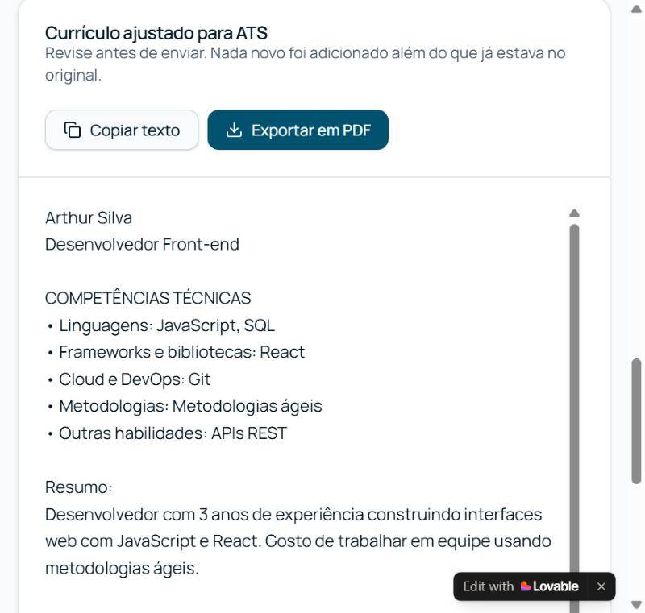

# DevMatch ATS

Aplicação web que compara um currículo com a descrição de uma vaga de tecnologia, mostra o percentual de match, aponta as palavras-chave técnicas que faltam e gera uma versão do currículo otimizada para passar por sistemas de ATS — sem nunca inventar experiência que a pessoa não tem.

**Aplicação publicada:** https://devmatch-ats.lovable.app

## O problema que resolve

Candidatos a vagas de tecnologia costumam ter currículos bons que nunca chegam ao RH, porque o **ATS (Applicant Tracking System)** — o software que ranqueia e filtra candidaturas automaticamente, antes de qualquer humano ler — descarta o currículo por falta de palavras-chave técnicas que aparecem na descrição da vaga (linguagens, frameworks, ferramentas, metodologias). O DevMatch ATS compara o currículo da pessoa com a vaga, mostra exatamente o que está faltando e gera uma versão ajustada, otimizada para passar pelo ATS.

Uma regra vale para a aplicação inteira: ela melhora como a pessoa se apresenta e **nunca inventa experiência** que a pessoa não tem. Esse compromisso fica visível na própria interface (rodapé da Home e aviso fixo na tela de resultado).

## Como a análise funciona

1. A pessoa cola a descrição da vaga em um campo de texto; no campo do currículo, pode colar o texto ou clicar em **Importar PDF** e subir o currículo antigo — o texto é extraído direto no navegador (com `pdfjs-dist`, sem o arquivo sair do navegador da pessoa) e preenche o campo automaticamente, podendo ser editado depois;
2. A aplicação extrai candidatos a palavras-chave técnicas da vaga (linguagens, frameworks, bibliotecas, bancos de dados, ferramentas de cloud/DevOps, metodologias, certificações e senioridade) a partir de uma lista local com cerca de 110 termos técnicos e suas variações mais comuns (ex: "JS"/"JavaScript", "Postgres"/"PostgreSQL", "React.js"/"ReactJS"/"React" contam como a mesma palavra-chave);
3. Verifica quais desses termos aparecem no currículo e calcula o percentual de match — termos que aparecem na seção de requisitos obrigatórios da vaga pesam mais no cálculo;
4. Agrupa as palavras-chave encontradas e as que faltam por categoria (Linguagens, Frameworks e bibliotecas, Bancos de dados, Cloud e DevOps, Metodologias, Outras habilidades);
5. Gera a versão ajustada do currículo reorganizando e destacando o que a pessoa já tem — expandindo siglas que ela já usou (ex: "JS" vira "JavaScript (JS)") e adicionando uma seção de competências técnicas com os termos que já estavam no texto original. As palavras-chave que faltam aparecem só como sugestão, separadas do currículo, nunca inseridas nele como se fossem experiência real;
6. A pessoa pode copiar o texto ajustado ou exportar em PDF.

Se o PDF importado não tiver texto extraível (por exemplo, for uma imagem escaneada), a aplicação avisa e pede para colar o texto manualmente. Textos muito longos (vaga, currículo colado ou extraído do PDF) são limitados a 20.000 caracteres.

Nesta primeira versão a extração de palavras-chave e a reescrita do currículo rodam inteiramente no navegador, com a lista local de termos — sem chamar um modelo de linguagem. O código já está estruturado para trocar essa lógica por uma chamada a uma IA depois, sem precisar redesenhar as telas.

## O mega prompt usado

O projeto inteiro foi gerado a partir de um único mega prompt em Markdown, escrito antes de abrir o Lovable e colado de uma vez só no modo **Build**. Ele descreve o problema, a regra de nunca inventar experiência, a especialização em vagas de tecnologia, o fluxo das 3 telas, os componentes do shadcn/ui a usar, a paleta de cores (azul petróleo `#0B4F6C` + verde `#10B981`, pensada para transmitir profissionalismo e aprovação), a lógica da análise e os requisitos técnicos. Ele não foi reescrito depois — a primeira geração já saiu com as três telas funcionando; os ajustes e evoluções que vieram depois foram pedidos por cima do resultado gerado (ver seções abaixo), não editando o prompt original.

<details>
<summary>Ver o mega prompt completo</summary>

```markdown
Crie uma aplicação web chamada DevMatch ATS.

## 1. Problema que resolve

Candidatos a vagas de tecnologia têm currículos bons que nunca chegam ao RH porque o ATS (Applicant Tracking System) — o software que ranqueia e filtra candidaturas automaticamente antes de qualquer humano ler — descarta o currículo por falta de palavras-chave técnicas que aparecem na descrição da vaga (linguagens, frameworks, ferramentas, metodologias). O DevMatch ATS compara o currículo da pessoa com a vaga, mostra exatamente o que está faltando e gera uma versão ajustada, otimizada para passar pelo ATS.

## 2. Regra inegociável

A aplicação melhora a forma como a pessoa se apresenta e nunca inventa experiência, tecnologia ou tempo de atuação que a pessoa não tem. O currículo ajustado só pode:
- Reorganizar, reescrever e destacar o que já está no currículo original;
- Usar sinônimos e termos técnicos equivalentes aos que a pessoa já mencionou (ex: se a pessoa escreveu "bancos de dados relacionais" e a vaga pede "SQL", pode aproximar os termos, mas não pode inventar "5 anos de PostgreSQL" do nada);
- Sugerir, como texto separado e claramente marcado como sugestão, palavras-chave que faltam — nunca inserir essas sugestões silenciosamente dentro do currículo gerado como se fossem experiência real.

Exiba esse compromisso de forma visível na interface (ex: um aviso fixo ou um bloco de texto na tela de resultados), com um texto como:
"O DevMatch ATS reorganiza e destaca o que você já tem. Ele nunca inventa experiência, tecnologia ou tempo de atuação que não estejam no seu currículo original."

## 3. Especialização: vagas de tecnologia

Diferente de um comparador genérico, o DevMatch ATS é otimizado para currículos e vagas da área de tecnologia (desenvolvimento, dados, produto, infraestrutura, QA etc). Isso significa:
- O extrator de palavras-chave deve priorizar termos técnicos: linguagens de programação, frameworks, bibliotecas, bancos de dados, ferramentas de cloud/DevOps, metodologias (Scrum, CI/CD, TDD), certificações e níveis de senioridade;
- Reconhecer variações comuns do mesmo termo técnico (ex: "JS" / "JavaScript"; "Postgres" / "PostgreSQL"; "React.js" / "ReactJS" / "React") como a mesma palavra-chave, para não gerar falsos negativos no match;
- Na tela de resultados, agrupar as palavras-chave por categoria técnica (ex: "Linguagens", "Frameworks e bibliotecas", "Bancos de dados", "Cloud e DevOps", "Metodologias", "Outras habilidades") em vez de uma lista única.

## 4. Fluxo principal (núcleo da v1)

1. A pessoa cola a descrição da vaga em um campo de texto;
2. A pessoa cola o próprio currículo em outro campo de texto;
3. A pessoa clica em Analisar;
4. A aplicação mostra:
   - Um percentual de match entre o currículo e a vaga, com destaque visual (ex: círculo ou barra de progresso, em verde quando o match é alto e em tons mais neutros/amarelos quando é baixo);
   - As palavras-chave técnicas encontradas no currículo que também aparecem na vaga, agrupadas por categoria;
   - As palavras-chave técnicas que faltam no currículo mas aparecem na vaga, agrupadas por categoria, com indicação visual de que são uma lacuna (ex: badge em tom de alerta, nunca vermelho de erro agressivo);
   - A versão ajustada do currículo, reescrita para incorporar de forma natural as palavras-chave que a pessoa já tem direito a usar (porque a experiência existe no original), em formato de texto limpo e pronto para revisão;
5. A pessoa pode exportar o currículo ajustado em PDF, com formatação limpa, pronta para envio.

Não implemente login, dashboard, histórico ou integrações nesta primeira versão — isso fica para depois.

## 5. Telas e componentes (usar shadcn/ui)

### Tela 1 — Home
- Hero simples: nome da aplicação, uma frase explicando o problema (currículo bom que o ATS barra antes do RH ver) e um botão "Analisar meu currículo" que leva à Tela 2;
- Um bloco curto explicando como funciona em 3 passos (cole a vaga → cole o currículo → veja o match e baixe a versão ajustada);
- Rodapé simples com o aviso da regra da seção 2.

### Tela 2 — Analisar
- Dois campos Textarea grandes, lado a lado em telas largas e empilhados em mobile:
  - "Descrição da vaga" (placeholder explicando que pode colar o texto completo do anúncio);
  - "Seu currículo" (placeholder explicando que pode colar o texto do currículo, sem precisar formatar);
- Contador de caracteres discreto em cada campo;
- Botão primário "Analisar compatibilidade", desabilitado até os dois campos terem conteúdo mínimo;
- Estado de carregamento (skeleton ou spinner) enquanto a análise roda.

### Tela 3 — Resultado
- Card de destaque no topo com o percentual de match (Progress ou indicador circular) e uma frase curta de interpretação (ex: "Bom match, mas faltam algumas palavras-chave importantes");
- Seção "Palavras-chave encontradas", com Badge verdes agrupados por categoria;
- Seção "Palavras-chave que faltam", com Badge em tom de alerta (âmbar), agrupados por categoria;
- Seção "Currículo ajustado para ATS", em um Card com o texto final, botão "Copiar texto" e botão "Exportar em PDF";
- Aviso fixo (componente Alert) reafirmando a regra da seção 2, visível nesta tela;
- Botão secundário "Analisar outra vaga", que limpa o estado e volta para a Tela 2.

## 6. Paleta de cores e design system

Usar shadcn/ui como base de componentes (Button, Textarea, Card, Badge, Progress, Alert, Tabs, Separator). Definir os tokens de tema (CSS variables / Tailwind) com esta paleta, pensada para transmitir profissionalismo (azul petróleo) e aprovação (verde):

- --primary: azul petróleo #0B4F6C — ações principais, cabeçalhos, elementos de destaque;
- --primary-foreground: #F8FAFC — texto sobre o azul petróleo;
- --secondary / cor de sucesso: verde #10B981 — usado no indicador de match alto e nos badges de palavras-chave encontradas;
- --accent: azul claro #E0F2FE — fundos suaves, hover states;
- --warning (uso customizado para badges de palavras-chave faltantes): âmbar #F59E0B, nunca o vermelho de erro padrão do shadcn, para não parecer que a aplicação está acusando um erro grave;
- --background: #F8FAFC (modo claro) com suporte a dark mode usando os mesmos tons em versão escura (#0B1420 de fundo, mantendo o azul petróleo e o verde como destaque);
- --muted: cinza-azulado #E2E8F0 para bordas e separadores;
- Tipografia: fonte sans-serif padrão do shadcn (Inter ou equivalente), títulos em peso semibold, corpo de texto em peso regular, boa legibilidade em blocos longos de texto (currículo e vaga colados).

Manter contraste AA em todos os textos sobre as cores de fundo.

## 7. Lógica da análise

Implementar a análise comparando o texto da vaga com o texto do currículo:
- Extrair candidatos a palavras-chave técnicas da descrição da vaga (termos de tecnologia, ferramentas, metodologias, seguindo a seção 3);
- Verificar quais desses termos aparecem (considerando variações/sinônimos comuns) no currículo;
- Calcular o percentual de match como a proporção de palavras-chave da vaga encontradas no currículo (pode usar peso maior para termos que aparecem múltiplas vezes ou em seções como "requisitos obrigatórios", se a vaga tiver esse tipo de estrutura);
- Gerar a versão ajustada do currículo reescrevendo o texto original para incorporar, nos pontos certos (resumo, experiências, habilidades), as palavras-chave que a pessoa já tem direito a reivindicar, sem adicionar afirmações novas de experiência.

Se a aplicação usar um modelo de linguagem para a extração de palavras-chave e a reescrita do currículo (recomendado para melhor qualidade), implementar isso via backend (edge function) do próprio Lovable, nunca expondo chaves de API no código do frontend. Se optar por uma abordagem sem IA generativa na v1 (correspondência de texto/sinônimos local), deixar claro no código que essa é uma versão inicial e estruturar para que a extração de palavras-chave e a reescrita do currículo possam ser trocadas por chamadas a um modelo de linguagem depois, sem redesenhar as telas.

## 8. Requisitos técnicos

- Aplicação React com Tailwind e shadcn/ui, responsiva (funciona bem em mobile e desktop);
- Estado da análise (vaga, currículo, resultado) gerenciado no cliente, sem necessidade de login nesta versão;
- Exportação do currículo ajustado em PDF a partir do texto gerado, com formatação legível (fonte, espaçamento, sem cortar conteúdo);
- Sem bancos de dados ou autenticação nesta v1 — tudo roda na sessão atual da pessoa;
- Nenhuma chave de API, token ou segredo hardcoded no frontend.

## 9. Fora de escopo nesta v1 (não implementar agora)

Exportar em .docx, histórico de análises em banco de dados, login com confirmação por e-mail, dashboard de evolução entre versões e otimização de SEO/GEO ficam para uma fase posterior de evolução do projeto — não implementar nesta primeira geração.
```

</details>

## Ajustes e evoluções feitas depois da primeira geração

A primeira geração no Lovable já saiu com as três telas funcionando e passou no teste manual (vaga + currículo de exemplo, 55% de match, palavras-chave corretas, currículo ajustado respeitando a regra). Depois disso, três rodadas de pedidos foram feitas por cima do resultado gerado:

1. **Botão da Home não navegava** — "Analisar meu currículo" só dava scroll até a seção de "como funciona" em vez de abrir a tela `/analisar`. Corrigido: a Home ainda não tinha sido publicada com a versão corrigida quando o teste foi feito a primeira vez — o link publicado estava desatualizado em relação ao código.
2. **Faltava o rodapé com o aviso da regra na Home** — o aviso "o DevMatch ATS nunca inventa experiência..." só aparecia na tela de resultado, não na Home, como o mega prompt pedia. Corrigido adicionando o mesmo aviso fixo no rodapé da Home (arquivo alterado: `src/routes/index.tsx`).
3. **Importar currículo em PDF** — para não precisar digitar ou colar o texto manualmente, foi adicionado um botão "Importar PDF" ao lado do campo de currículo, que extrai o texto do PDF direto no navegador (sem subir o arquivo a lugar nenhum) e preenche o campo automaticamente.

## Stack

- React + TanStack Start, TypeScript, Tailwind CSS, shadcn/ui
- Leitura e geração de PDF no cliente: `pdfjs-dist` para importar o currículo antigo, `jspdf` para exportar o currículo ajustado
- Sem backend, banco de dados ou autenticação nesta versão — toda a análise roda na sessão do navegador

## Segurança

O que já é garantido por como a v1 foi construída:
- **Sem backend, banco de dados ou autenticação**: toda a análise roda no navegador, dentro da sessão da pessoa. A vaga e o currículo (colado ou importado de um PDF) nunca saem do navegador nem são salvos em lugar nenhum.
- **Sem chaves de API, tokens ou segredos no código** — nesta versão não existe nenhuma chamada a serviço externo que exigisse isso; o match é 100% calculado localmente.
- **Sem risco de XSS a partir do texto colado ou importado**: o React renderiza a vaga, o currículo e o resultado sempre como texto puro, nunca via `dangerouslySetInnerHTML`. A única ocorrência disso no projeto é no componente de gráfico do shadcn/ui (não usado nesta v1), que injeta só CSS fixo de tema — nunca dado digitado ou extraído de um PDF pela pessoa.
- **Exportação em PDF 100% no cliente**: o currículo ajustado nunca é enviado para um servidor para virar PDF.

Reforços de segurança aplicados depois da primeira versão (confirmados direto nos cabeçalhos da resposta do site ao vivo):
- **Cabeçalhos HTTP de segurança** em todas as respostas (`src/lib/security-headers.ts`): `Content-Security-Policy` restringindo scripts, estilos e fontes ao próprio domínio e ao Google Fonts, e bloqueando a página de ser exibida dentro de sites de terceiros via `frame-ancestors`; `X-Content-Type-Options: nosniff`; `Referrer-Policy: strict-origin-when-cross-origin`; `Permissions-Policy` desativando câmera, microfone e geolocalização (a aplicação não usa nenhum dos três).
- **Limite de 20.000 caracteres** nos campos de vaga e currículo (incluindo o texto extraído de um PDF importado), para evitar que um texto gigante trave a análise no navegador da pessoa.
- Checagem de segurança automática da Lovable rodada depois dessas mudanças: nenhum problema encontrado.

Pontos de atenção para quem for evoluir o projeto:
- O domínio de publicação (`*.lovable.app`) tem analytics básico de visitantes ativado por padrão — vale revisar ou desativar se o projeto crescer.
- Se uma versão futura adicionar IA generativa (como o mega prompt já prevê na seção 7), a chave do provedor deve ficar só no backend (edge function do Lovable), nunca no frontend.
- Nesta v1 não há login nem dado de usuário persistido para proteger — isso muda assim que histórico ou autenticação forem adicionados, fora do escopo atual.

## Capturas de tela

**Home** — proposta e os 3 passos do fluxo:



**Resultado da análise** — percentual de match e o aviso de que a aplicação nunca inventa experiência:



**Palavras-chave encontradas e que faltam**, agrupadas por categoria:



**Currículo ajustado para ATS**, pronto para copiar ou exportar em PDF:



## Rodando localmente

```bash
git clone https://github.com/ArthurDavino/devmatch-ats.git
cd devmatch-ats
npm i
npm run dev
```

---

Projeto construído com [Lovable](https://lovable.dev) a partir do mega prompt acima, como parte de um desafio de projeto sobre construir aplicações com IA generativa.
